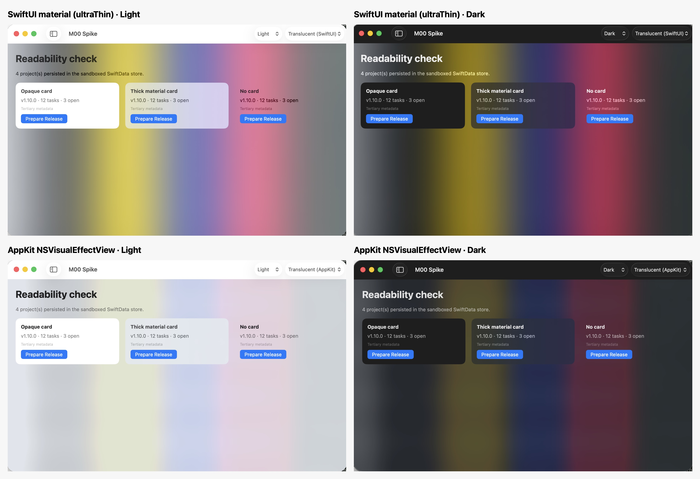

# M00 — Technical Validation Report

Status: **Complete** · Started 2026-10-19 · Completed 2026-10-21 · Spike code: [`spikes/M00/`](../spikes/M00/README.md)

Every result below was produced by a command that was actually run, unless marked **PENDING** or **DOC-ONLY**.

## 1. Development environment

| Item | Value |
|---|---|
| Hardware | MacBook Air, Apple M4, 24 GB, arm64 |
| macOS | 26.6.2 (25G83) |
| Xcode | 26.6 (17F113) |
| Swift | 6.3.3 (swiftlang-6.3.3.1.3) |
| macOS SDK | 26.5 |
| Swift Testing | Library version 1902 (bundled) |
| Signing | Apple Development identity (personal team; ID kept out of the repo). **No Developer ID identity**, and only iOS provisioning profiles |
| Tooling | git 2.49, gh CLI. No XcodeGen, Tuist, SwiftLint, or SwiftFormat. `swift-format` 6.3 ships with Xcode |

**Minimum macOS target: macOS 26** (owner decision, 2026-10-21; [ADR 0003](decisions/0003-minimum-macos-target.md)). The plan did not specify one. The spikes were built with a 15.0 deployment target, before the decision.

## 2. Results by M00 task

### 2.1 Minimal SwiftUI app with local persistence: **PASS**

What was built:
- A sandboxed `.app` (`M00SpikeApp`) using SwiftData behind a `ProjectRepository` protocol.
- An actor-based `ModelActor` repository that returns plain `Sendable` structs.
- Swift 6 language mode, with `SWIFT_DEFAULT_ACTOR_ISOLATION = MainActor` in the app target.

Evidence:

```text
$ M00Spike --env
sandboxed=true container=com.erickpea29.ReleaseManager.M00Spike
store=~/Library/Containers/com.erickpea29.ReleaseManager.M00Spike/Data/Library/Application Support/M00Spike/spike.store
$ M00Spike --seed "Release Manager"   # separate process
$ M00Spike --seed "Second Project"    # separate process
$ M00Spike --dump                     # fresh process
projects=2
- Release Manager [release-manager] DF42442D-…
- Second Project [second-project] 15B17561-…
```

`swift test` passes 12 tests in 4 suites, and passed 5 of 5 repeated runs:
- Data survives a container restart (an on-disk store is reopened by a new container).
- Update and delete round-trip.
- **Migration:** an on-disk V1 store migrates through a lightweight stage (V1→V2, adds an optional field) and a custom stage (V2→V3, backfills a derived non-optional field) to V3.

Findings:
- **F1 — Concurrent tests across schema versions crash.** Creating a container for an older `VersionedSchema` while another test in the same process uses the current schema crashes with `NSUnknownKeyException: the entity ProjectEntity is not key value coding-compliant for the key "slug"`. Core Data resolves the shared entity name against the wrong model.
  - The app is not affected, because it loads one schema at a time.
  - Rule for M01: migration tests run in a `.serialized` suite. Prefer committed fixture store files over building old schemas in-process.
- **F2 — Write `ModelActor` conformance by hand.** The `@ModelActor` macro's generated initializer is not public, so a cross-module repository conforms to `ModelActor` explicitly (a few lines of code).
- **F3 — Non-Sendable migration stages.** `MigrationStage` is not `Sendable`, so `stages` and `schemas` must be computed properties under Swift 6, not `static let`.

### 2.2 Xcode project and package boundary: **PASS**

The Xcode project file was written by hand, using Xcode 16+ synchronized folders (`objectVersion = 77`). It links two library products from a local Swift package (`XCLocalSwiftPackageReference`). It builds with `xcodebuild` and no generator tool. See [ADR 0004](decisions/0004-project-structure-and-tooling.md).

### 2.3 Token storage: **PASS (file-based keychain)** / **BLOCKED (data-protection keychain)**

| Build | File-based keychain | Data-protection keychain |
|---|---|---|
| Ad-hoc ("Sign to Run Locally"), sandboxed | write/read/delete PASS | `-34018 errSecMissingEntitlement` |
| Apple Development, manual, no profile, sandboxed | write/read/delete PASS | `-34018 errSecMissingEntitlement` |
| Apple Development, **different binary** (Release vs Debug), same identity | item written by the Debug build is readable by the Release build with UI disallowed: **no prompt** | n/a |

Findings:
- **F4 — The data-protection keychain needs a provisioning profile.** It requires an application-identifier or keychain-access-group entitlement, and that requires a Mac provisioning profile. Creating one registers this Mac and an App ID on the Apple Developer account, so it was not done without approval. The MVP uses the file-based keychain behind a `CredentialStore` protocol. See [ADR 0005](decisions/0005-credential-storage.md).
- **F5 — Changing the signer for the same bundle ID blocks launch.** A sandboxed app's container is bound to the signer that created it. Launching a build with a different signer under the same bundle ID stalls inside `_libsecinit_appsandbox`, waiting on a system consent dialog, before any app code runs. The stack trace was observed with `sample`.
  - Rule: one signing identity per bundle ID.
  - Local team signing goes in a git-ignored `Config/Local.xcconfig`.
  - Never mix ad-hoc and team-signed builds of one bundle ID on the same Mac. CI runners start clean, so they are unaffected.
- Ad-hoc builds change their code hash on every build. With the file-based keychain, that is expected to trigger an access prompt on the next read. Not tested, to avoid putting dialogs on screen; this is a reason to sign development builds with the team identity.

### 2.4 Window translucency: **PASS** (visual check 2026-10-21)

The spike app offers three modes: Opaque, Translucent (SwiftUI `containerBackground(.ultraThinMaterial, for: .window)`), and Translucent (AppKit `NSVisualEffectView`, `underWindowBackground`, `.behindWindow`). Reduce Transparency forces Opaque.

Each mode was screenshotted in light and dark over a full-screen, high-contrast test pattern (saturated bright/dark bands with text):



| Mode | Translucency | Readability |
|---|---|---|
| Opaque | None (sidebar and toolbar still get system Liquid Glass) | All text readable in both appearances |
| SwiftUI `ultraThinMaterial` | **Strong**: background colors show through almost unblurred | Cards fine. **Text placed directly on the background loses contrast**: secondary text takes on the backdrop's color (pink on red, yellow on yellow), and tertiary text is near-illegible over saturated colors |
| AppKit `NSVisualEffectView` | **Clear but muted**: the backdrop is blurred and tinted toward the window color | **All text readable in both appearances**, including text with no card behind it. Secondary and tertiary text stay neutral |

Findings:
- **F6 — System chrome translucency is automatic on macOS 26.** `NavigationSplitView` sidebars (`NSContainerConcentricGlassEffectView`) and toolbar items (`NSGlassEffectView`) get Liquid Glass in every mode. It is system-managed and accessible.
- **F7 — Use the AppKit path for full-window translucency.** It works without clearing any column backgrounds. `ultraThinMaterial` is too thin for text-bearing areas.
  - *Correction:* the earlier layer-tree inspection suggested the SwiftUI mode had no visible effect. Screenshots show the opposite; the blur is composited outside the app's own layer tree.
- **F8 — macOS has only one container-background placement.** `ContainerBackgroundPlacement` offers only `.window` on macOS.
- **F9 — Inactive windows lose their translucency.** macOS flattens behind-window materials when the window is inactive (`followsWindowActiveState`). This is expected and helps readability.
- **F10 — The toolbar band stays opaque** in both translucent modes, which leaves a visible seam under the title bar. Polish item for M05.
- **F11 — The sidebar was restored collapsed** across launches. The product must manage column visibility explicitly, as a stored preference ("Sidebar visibility" in the plan).
- **F12 — Window-only screenshots hide translucency.** `screencapture -l` renders materials against a neutral background, so translucency evidence must use region captures.
- Reduce Transparency → Opaque is implemented through the `accessibilityReduceTransparency` environment value, but has not been exercised by toggling the system setting (needs a manual toggle).

### 2.5 GitHub App authorization: **PASS**

Live run on 2026-10-21 with the registered app (client ID only), `gh-auth-spike validate --repo erickpea29/Release-Manager`:

| Check | Result |
|---|---|
| Device flow with the client ID only | **PASS.** User approved at github.com/login/device and received a `ghu_` user token: `expires_in=28800` (8 h), refresh token present, `refresh_token_expires_in=15724800` (182 days) |
| Refresh **without** client secret | **PASS.** The new token works (`GET /user` 200) |
| Refresh-token rotation | **Confirmed.** The old access token returns **401** right after refresh |
| Rate limit | `x-ratelimit-limit: 5000` per hour for the user token |
| Installation discovery | `GET /user/installations` 200. First run: **0 repositories and no permissions**, because the app had been registered without repository permissions, so installing it offered only "No repositories". After adding the permissions and accepting them on the installation: `repos=[erickpea29/Release-Manager]`, granted `contents=write, metadata=read, pull_requests=read` |
| Repository endpoints (with access) | **All 200:** repo (`private=true`, `push=true`), releases, tags, branches, commits, `commits/{sha}/pulls`, `git/matching-refs/tags`, pulls, `POST releases/generate-notes`. Before access was granted: all **404**, because GitHub hides inaccessible private repositories |
| Draft release (`POST /releases`, `draft: true`, `target_commitish` = full SHA) | **201**; the full SHA is kept as the target. Accepts `contents=write`, or `contents=write,workflows=write` for commits touching workflows |
| Does a draft create its tag? | **No.** `git/ref/tags/<tag>` is 404 before and after creating the draft. The tag appears only on publication |
| Second draft with the **same** tag | **201: accepted.** GitHub returns no 422 and gives drafts no duplicate protection (F13) |
| Cleanup | Both drafts deleted (204). 0 releases and 0 tags remain, independently verified with `gh` |
| Required permission per endpoint (`x-accepted-github-permissions`, sent even on 404) | `/user` and `/user/installations`: none (`allows_permissionless_access`). Installation repositories, repo metadata, tags: `metadata=read`. Releases, branches, commits: `contents=read`. Pulls: `pull_requests=read`. `generate-notes`: `contents=write`. **Matches the documented minimum set** |

Not exercised: `compare` (the repository has no tags yet; same `contents=read` family as commits). The local spike token was deleted after the run.

- **F13 — GitHub does not prevent duplicate drafts.** Two drafts for the same not-yet-existing tag are both accepted, so idempotency is the app's job:
  - Before every create, and after any timeout, list releases (drafts included) and match on `tag_name`.
  - Persist `githubDraftReleaseID` immediately.
  - The plan's "check GitHub before retrying" rule is mandatory, not merely defensive.

Setup lesson for the guide: an app registered without repository permissions can only be installed with "No repositories". Permissions must be set *before* installing, or accepted on the installation afterward.

Documentation research (official docs, fetched 2026-10-19):

Summary of the documentation research (official docs, fetched 2026-10-19):

| Question | Finding |
|---|---|
| Secret needed for device flow? | **No.** "The `client_secret` is not needed for the device flow." Requires **Enable Device Flow** in app settings. |
| Token lifetime | User token 8 h, refresh token 6 months. Refresh rotates both tokens. |
| Secret needed to refresh? | **No for device-flow tokens.** `client_secret`: "Required unless the user access token was generated using the device flow." **Verified live.** |
| Revoke without a secret? | **No.** `DELETE /applications/{client_id}/token\|grant` needs Basic auth with the secret. Disconnect deletes local tokens and links to *Settings → Applications → Authorized GitHub Apps*. |
| Is a backend needed? | **No** for any MVP feature. The web flow with PKCE still requires the secret, so the device flow is the only secretless option. |
| Repository reach | Only repos where the app is **installed** and the user has access: `GET /user/installations` → `/user/installations/{id}/repositories`. Install via `https://github.com/apps/<slug>/installations/new`. |
| Device-flow risk | GitHub's best-practices page discourages the device flow outside "constrained environments" because of phishing, while its token page recommends it for desktop apps. Mitigation: start the flow only on user action, show the code in-app, and open the `verification_uri` from the app. |
| API version | `2026-03-10` is current; `2022-11-28` is supported until 2028-03-10. **`2026-03-10` removes `merge_commit_sha` from PR responses.** Decide in M03. |
| Draft tag semantics | **Verified live:** a draft does not create its tag, and duplicate drafts for one tag are accepted (F13). |

Minimum permission set (DOC-ONLY until the live probe confirms it via `x-accepted-github-permissions`):

| Permission | Level | Needed for |
|---|---|---|
| Metadata | read | repo info, tags, installation repo lists |
| Contents | **write** | releases, refs, compare, commits, branches (read), plus `POST /releases` and `generate-notes` (write) |
| Pull requests | read | `/pulls`, `/commits/{sha}/pulls` |
| Workflows | write, **only if** release targets may add or modify `.github/workflows/*` | `POST /releases` in that case. Excluded from the MVP; surface the error instead |

No organization or administration permissions are needed, so repository admins (not only org owners) can install the app.

## 3. Acceptance criteria

| Criterion | Status |
|---|---|
| A minimal native app builds and runs | **PASS** |
| Local data saved and restored after restart | **PASS** (separate process launches, sandboxed) |
| GitHub authorization validated without embedding confidential credentials | **PASS.** Live device flow and refresh with the client ID only |
| Required GitHub permissions documented and minimized | **PASS.** All needed endpoints return 200 with exactly `contents=write, metadata=read, pull_requests=read` |
| Translucency works with a readable opaque fallback | **PASS.** AppKit translucent mode readable in both appearances over a high-contrast backdrop, and opaque fallback works. The Reduce Transparency toggle has not been exercised manually |
| Unresolved technical risks documented | **PASS** (section 4) |

## 4. Open risks and decisions needed before M01

1. ~~Minimum macOS version~~: **decided, macOS 26** ([ADR 0003](decisions/0003-minimum-macos-target.md)).
2. ~~GitHub App registration, live auth, repository access, draft semantics~~: **done 2026-10-21** (§2.5).
3. ~~Visual translucency check~~: **done 2026-10-21** (§2.4). Optional: toggle Reduce Transparency once to confirm the fallback.
4. **Distribution.**
   - Only an Apple Development certificate exists. Notarized distribution needs a Developer ID certificate (paid Apple Developer Program).
   - The data-protection keychain needs a provisioning profile.
   - Decide in M05; no impact on M01–M04.
5. **Identity choices:** final bundle ID (spike uses `com.erickpea29.ReleaseManager.*`), app name, and GitHub App name.
6. **Product gaps** in the plan, listed in [PRODUCT_SPEC §6](PRODUCT_SPEC.md#6-open-questions-and-plan-gaps): snapshot timing vs. immutability, release-plan↔repository link, and others.

## 5. Commands executed

```text
xcodebuild -version; swift --version; sw_vers; xcodebuild -showsdks; security find-identity -v -p codesigning
cd spikes/M00/SpikeKit && swift build && swift test          # 12/12 pass, 5/5 repeated runs (after F1 fix)
xcodebuild … build (ad-hoc, Debug)                            # BUILD SUCCEEDED
xcodebuild … build (Apple Development, Debug + Release)       # BUILD SUCCEEDED
M00Spike --env | --seed | --dump | --keychain | --keychain-write | --keychain-read
M00Spike -windowMaterial {opaque,swiftUIMaterial,appKitVisualEffect} -appearance {light,dark} -inspectWindow YES
```
